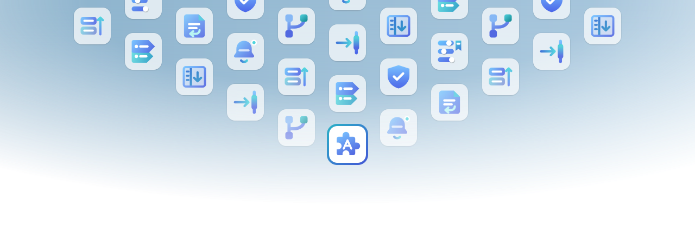

# Plugin banner artwork



The banner reconstructs the supplied PowerToys composition at 1280 × 440. Plugin glyphs come from `packages/*/icon.svg`. An optically centered blue puzzle piece with a white A represents Agou DSH Plugins. Its card shares the other cards' size, corner radius, shadow, and glyph scale. The main card sits outside the field opacity mask, with an opaque white surface and fully opaque glyph and border. A 4-pixel blue-cyan border identifies the main card.

## Generate

After installing the repository's development dependencies with pnpm, run:

```sh
pnpm artwork:generate
pnpm artwork:compare --reference .tmp/artwork/reference/powertoys.png
```

CI regenerates the banner after a push to `main`; see [Continuous integration](#continuous-integration). The local generator remains the way to preview a change before pushing.

The comparison command requires a local reference PNG supplied with `--reference`. Reference images and comparison outputs are excluded from version control. Generating the banner and icon does not require a reference image.

The scripts use Node 22 and pinned `@resvg/resvg-js`, `@xmldom/xmldom`, `pngjs`, and `pixelmatch` versions. Rendering uses no browser, system fonts, network assets, or raster images embedded in the generated SVGs.

| Asset | SVG | PNG | Dimensions |
| --- | --- | --- | --- |
| Plugin banner | [banner.svg](assets/brand/banner.svg) | [banner.png](assets/brand/banner.png) | 1280 × 440 |
| Main plugin icon | [icon.svg](assets/brand/icon.svg) | [icon.png](assets/brand/icon.png) | 256 × 256 |

[icon.svg](assets/brand/icon.svg) is the authored vector source. Its 36-unit viewBox follows the plugin icons' coordinate scale. The asymmetric puzzle silhouette is optically balanced around `(18, 18)`, and the generator preserves that authored center instead of recentering its bounding box. The white A is vector geometry, so it does not depend on installed fonts. The remaining images are generated. Both PNGs include transparency.

The default output directory is `docs/assets/brand`. A custom output directory receives all four image files and the layout manifest:

```sh
node scripts/generate-artwork.mjs --output .tmp/artwork-export
node scripts/generate-artwork.mjs --seed another-fixed-seed --output .tmp/artwork-variation
node scripts/compare-artwork.mjs --reference .tmp/artwork/reference/powertoys.png --actual .tmp/artwork-export/banner.png --output .tmp/artwork-comparison
```

Both scripts accept `--help`. `--root` selects the repository whose icon inputs should be read, which also supports running the generator from an isolated dependency installation. Output paths that would overwrite input plugin icons or comparison images are rejected.

## Repeat icons consistently

The default seed is `agou-dsh-plugins-v1`. Package names are sorted before a seeded shuffle assigns balanced quotas. The generator then assigns icons to the most constrained positions first, backtracking when necessary. Every neighbor conflict is forbidden. Neighbors include any two cards whose horizontal separation is at most 188 pixels and whose vertical separation is at most 94 pixels, covering horizontal, vertical, and diagonal positions in the staggered layout.

With the existing nine icons, 25 surrounding cards give each icon two or three appearances. The main card appears once. This neighborhood contains a group of five mutually adjacent cards, so at least five distinct plugin icons are required. The generator reports an error if the available inputs or search limit prevent a valid arrangement; it never silently permits adjacent duplicates. If there are more than 25 plugins, the seed selects a subset. Adding, removing, or renaming a plugin can change assignments across the banner.

Run `pnpm artwork:test` to check adjacency boundaries, 100 seeds for nine icons, input-order independence, balanced layouts with five through thirty icons, and invalid inputs.

The same inputs and seed produce byte-identical SVG and PNG files. There is no clock-based randomness. Rendering is also identical across operating systems, so a regenerated file never produces a spurious diff. [layout.json](assets/brand/layout.json) records the seed, input hashes, assignments, counts, and main-card placement.

## Continuous integration

The [Artwork workflow](../.github/workflows/artwork.yml) regenerates the banner on every push to `main` and commits the result when plugin icons changed, so the banner does not drift from `packages/*/icon.svg`. It runs `node scripts/refresh-artwork.mjs --commit`:

```sh
node scripts/refresh-artwork.mjs            # regenerate and report what changed
node scripts/refresh-artwork.mjs --commit    # also commit as github-actions[bot] and push
```

The job is skipped on the push its own commit creates, and a push that loses a race is regenerated on top of the new tip rather than forced. `--commit` refuses to start when the worktree has changes outside `docs/assets/brand`, because recovering from a lost race resets to `origin/main`. Run the plain form locally to preview the banner after changing a plugin icon.

## Geometry and appearance

The layout was measured from a supplied 1280 × 440 RGBA PowerToys image, attributed to Microsoft. That reference is a local comparison input and is not distributed with this repository.

- Cards are 68 × 68 pixels, with a 15-pixel corner radius, 94-pixel column spacing, and 26-pixel vertical gaps. Each glyph is fitted into a 44 × 44 pixel region.
- The center column is 16 pixels above the adjacent staggered columns. Some cards intentionally extend above the canvas.
- Surrounding cards use a 70% white fill over the blue field, with a fine external outline and a separate external shadow.
- An elliptical opacity mask covers the background and surrounding cards. Its measured center is `(628.856, -0.45)` and its radii are `(1102.932, 379.452)`. Opacity stays full through the 0.416715 stop and reaches zero at the ellipse boundary.
- The main card occupies `(606, 233, 68, 68)`, continuing the center column's 94-pixel rhythm. It is rendered after the masked field, with a 100% opaque white surface, glyph, and colored border.
- The canvas has square corners. Individual cards retain their rounded corners.

Coordinates and assignment logic live in [layout.mjs](../scripts/artwork/layout.mjs). Background, masks, borders, shadows, and the shared card renderer live in [svg.mjs](../scripts/artwork/svg.mjs). Plugin SVGs are parsed as XML, fitted to their visible bounds, and given unique ID prefixes for every instance, including gradients and filters.

## Image comparison

The comparison calibrates reconstruction against the local reference passed with `--reference`. Its default output directory is `.tmp/artwork/qa`, which Git ignores. It emits:

- `comparison.png`: reference, generated banner, and structural diff on white.
- `diff-full.png`: the complete comparison, including replacement artwork.
- `diff-structure.png`: background, surrounding card placement, surfaces, borders, and shadows.
- `intentional-changes.png`: magenta regions excluded from structural measurements.
- `report.json`: input hashes, comparison settings, pixel counts, and color/alpha errors.

The structural mask is declared from the design in `layout.mjs`: each card's 50 × 50 glyph region, the replaced central reference artwork and its original shadow, and the two changed top corners. The main card intentionally differs from the original PowerToys foreground emblem, so its appearance is checked visually rather than counted as reference agreement. Fully transparent pixels in both images do not count toward agreement. Antialiasing differences are included. Pixelmatch compares transparency against a checkerboard.

The report includes both a 0.05 perceptual threshold and a stricter 0.01 threshold, plus mean premultiplied RGB and alpha errors. These measurements describe structural reproduction, not exact pixel identity. The complete-image metric includes the replacement glyphs and main card.

The report is regenerated from actual PNG files. The source image is never embedded as a background in the generated artwork.
